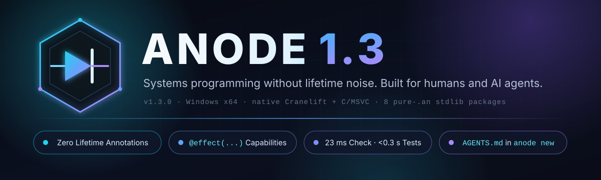

<p align="center">
  
</p>

<p align="center">
  <a href="../../releases/latest"></a>
  
  
  
  
</p>

<p align="center">
  <a href="#why-anode">Why Anode</a> ·
  <a href="#c-vs-rust-vs-anode">C vs Rust vs Anode</a> ·
  <a href="#install-in-10-seconds">Install</a> ·
  <a href="#standard-library">Standard library</a> ·
  <a href="#built-for-ai-agents">AI agents</a> ·
  <a href="AGENTS.md">Language guide</a> ·
  <a href="docs/API-DOCS.md">API docs</a>
</p>

---

**Anode** is a compiled systems language with Rust-like syntax and no lifetime annotations. Instead of lifetimes, borrows are scoped: a view of a string or buffer lives exactly as long as the `borrow` block that created it. Functions state what they touch with **field views**, what they are allowed to do with **`@effect(...)`**, and what they promise with **`requires` / `ensures`**. The compiler checks all of it in milliseconds, then builds native executables with Cranelift or optimized C through MSVC.

```anode
pub struct Counter { value: int, step: int, label: text }

// May write `value` and read `step`; `label` is out of reach.
@effect(no_alloc, no_io, bounded)
pub fn advance(c: &mut Counter.{ mut value, step }) -> int requires c.step > 0 && c.value >= 0;
ensures result > 0;
{
    c.value = c.value + c.step;
    return c.value;
}
```

## Why Anode?

| Feature | What you write | What the compiler guarantees |
| :--- | :--- | :--- |
| **Partial field views** | `c: &mut Counter.{ mut value, step }` | The function can write `value`, read `step`, and nothing else; callers keep using disjoint fields while it runs. |
| **Compile-time effects** | `@effect(no_alloc, no_io, bounded)` | No heap allocation, no I/O and provably finite control flow, checked transitively through every call. |
| **Contracts** | `requires c.step > 0;` `ensures result > 0;` | Checked on every call in every build mode; `anode verify` samples them in RAM without building. |
| **Scoped borrows instead of lifetimes** | `borrow line = region(src, start, end) { ... }` | Zero-copy views that cannot escape their block, so no `'a` anywhere. |
| **Generational arenas & columnar vectors** | `pub arena Nodes(Node);` `pub soa vector Rows(Row);` | Stale handles are detected instead of dangling; SoA stores one contiguous column per field. |
| **Two backends** | `anode run .` / `anode build . --release` | Native Cranelift for fast builds, optimized C/MSVC (with optional AddressSanitizer) for releases. |
| **Checked arithmetic everywhere** | `a + b` | Overflow, bounds and conversion faults in every build mode; there is no unchecked mode. |
| **AI-native tooling** | `anode new my_app` | `AGENTS.md` and `CLAUDE.md` are baked into the binary and written into every new project; `anode check . --json` returns structured diagnostics in milliseconds. |

## C vs Rust vs Anode

The same task in all three languages: scan `label|amount` lines, skip blank and `#` lines, and count rows, the amount total and malformed lines. All three were compiled (MSVC `/W4`, `rustc 2021`, `anode check`) and print `2 10 1` for the input `"# c\nalpha|12\nbad\nb|-2\n"`.

| | C | Rust | Anode |
| :--- | :--- | :--- | :--- |
| Buffer bounds | Checked by hand (`digits[32]`) | Checked | Checked (`region` views) |
| Lifetime annotations | — | `Entry<'a>`, `parse<'a>` | None: views are scoped to `borrow` blocks |
| "No heap, no I/O, always terminates" in the signature | No | No | `@effect(no_alloc, no_io, bounded)`, checked |
| Pre/postconditions | Comments | Comments or `debug_assert!` | `requires` / `ensures`, checked on every call |
| Integer overflow | Undefined behavior (signed) | Panics in debug, wraps in release | Faults in every build mode |

<details open>
<summary><b>Anode</b> — <code>src/main.an</code></summary>

```anode
pub struct Stats {
    rows: int,
    total: int,
    errors: int
}
// Folds one "label|amount" line into `s`: no heap, no I/O, always finishes.
@effect(no_alloc, no_io, bounded)
fn add_line(line: &str, s: &mut Stats.{ mut rows, mut total, mut errors }) {
    for i in 0..len(line) {
        if byte_at(line, i) == 124 {
            borrow digits = region(line, i + 1, len(line)) {
                if i > 0 && is_int(digits) {
                    s.rows = s.rows + 1;
                    s.total = s.total + parse_int(digits);
                    return;
                }
            }
            break;
        }
    }
    s.errors = s.errors + 1;
}
@effect(no_alloc, no_io, bounded)
pub fn scan(src: &str) -> Stats requires len(src) <= 16777216;
ensures result.rows + result.errors <= len(src);
{
    let mut s = Stats { rows: 0, total: 0, errors: 0 };
    let mut start = 0;
    for i in 0..len(src) + 1 {
        if i == len(src) || byte_at(src, i) == 10 {
            if i > start && byte_at(src, start) != 35 {
                borrow line = region(src, start, i) {
                    add_line(&line, &mut s);
                }
            }
            start = i + 1;
        }
    }
    return s;
}
```
</details>

<details>
<summary><b>Rust</b> — memory-safe, but the borrowed label needs <code>'a</code> on the struct and the function, and nothing in the signature says it never allocates, never does I/O or always terminates</summary>

```rust
#[derive(Debug, Default)]
pub struct Stats {
    pub rows: u64,
    pub total: i64,
    pub errors: u64,
}

/// A parsed row borrows its label from the line, so the struct
/// and the function both carry the lifetime `'a`.
pub struct Entry<'a> {
    pub label: &'a str,
    pub amount: i64,
}

pub fn parse<'a>(line: &'a str) -> Option<Entry<'a>> {
    let (label, digits) = line.split_once('|')?;
    if label.is_empty() {
        return None;
    }
    let amount = digits.parse::<i64>().ok()?;
    Some(Entry { label, amount })
}

pub fn scan(src: &str) -> Stats {
    let mut s = Stats::default();
    for line in src.lines() {
        if line.is_empty() || line.starts_with('#') {
            continue;
        }
        match parse(line) {
            Some(entry) => {
                s.rows += 1;
                s.total += entry.amount;
            }
            None => s.errors += 1,
        }
    }
    s
}
```
</details>

<details>
<summary><b>C</b> — fast and small, but every length, buffer size and overflow is the programmer's job</summary>

```c
#include <stdlib.h>
#include <string.h>

typedef struct { long rows, total, errors; } Stats;

/* Caller must pass the true length of `line`; nothing checks it. */
static int parse_amount(const char *line, size_t len, long *amount) {
    const char *bar = memchr(line, '|', len);
    if (!bar || bar == line) return 0;
    char digits[32];                          /* fixed buffer: size checked by hand */
    size_t n = len - (size_t)(bar + 1 - line);
    if (n == 0 || n >= sizeof digits) return 0;
    memcpy(digits, bar + 1, n);
    digits[n] = '\0';
    char *end;
    *amount = strtol(digits, &end, 10);       /* out-of-range input silently clamps */
    return *end == '\0';
}

Stats scan(const char *src, size_t len) {
    Stats s = {0, 0, 0};
    size_t start = 0;
    for (size_t i = 0; i <= len; i++) {
        if (i == len || src[i] == '\n') {
            if (i > start && src[start] != '#') {
                long amount;
                if (parse_amount(src + start, i - start, &amount)) {
                    s.rows++;
                    s.total += amount;        /* signed overflow is undefined */
                } else {
                    s.errors++;
                }
            }
            start = i + 1;
        }
    }
    return s;
}
```
</details>

## Install in 10 seconds

**Requirements:** Windows 10 or 11 (x64) and **Visual Studio 2022 Build Tools** with the C++ workload. Anode links executables with MSVC's `link.exe` and uses `cl.exe` for `--release`, `--sanitize` and the C backend.

1. Download **[`anode-1.3.0-windows-x64.zip`](../../releases/latest/download/anode-1.3.0-windows-x64.zip)** from [Releases](../../releases/latest) and extract it, for example to `C:\Tools\anode-1.3.0-windows-x64`.
2. From that folder, run the per-user installer. It puts `bin\` on your user `PATH` and sets `ANODE_HOME`; nothing is copied and no administrator rights are needed (`-WhatIf` previews, `-Uninstall` reverts).
   ```powershell
   powershell -ExecutionPolicy Bypass -File .\install.ps1
   ```
3. In a new terminal:
   ```powershell
   anode new hello_anode       # Anode.toml, src/, .gitignore, AGENTS.md, CLAUDE.md
   cd hello_anode
   anode run .                 # Hello from Anode
   anode test .                # runs `test name() { ... }` blocks
   anode check . --json        # structured diagnostics in milliseconds
   ```

| Command | What it does |
| :--- | :--- |
| `anode check . --json` | Type, ownership, borrow, view and effect checking (about 23 ms for the 9-file showcase) |
| `anode test . --jobs 4` | Unit tests in parallel (35 showcase tests in about 0.27 s after an edit) |
| `anode run . -- ARGS` | Build with the native backend and run |
| `anode build . -o app.exe` | Native executable; add `--release` for optimized C/MSVC |
| `anode fmt .` | Canonical formatting (`--check` only reports) |
| `anode verify . --json` | Bounded `requires` / `ensures` sampling in RAM |
| `anode doctor` | Toolchain report |

## Standard library

Eight packages written in pure `.an`, with every capability switched off: they never touch files, processes or the network. Import them as path dependencies in `Anode.toml`:

```toml
[dependencies]
json = { path = "C:/Tools/anode-1.3.0-windows-x64/packages/json" }
cli = { path = "C:/Tools/anode-1.3.0-windows-x64/packages/cli" }
```

| Package | Like | Highlights | Key functions |
| :--- | :--- | :--- | :--- |
| [`cli`](packages/cli/src/lib.an) | `clap` | Subcommands, `--key=value`, `--flag`, `-abc` clusters, `--` separator, aligned help | `parse_args`, `has_flag`, `flag_value_or`, `render_help` |
| [`encoding`](packages/encoding/src/lib.an) | `crc32fast`, `hex`, `base64` | IEEE CRC-32 and RFC 4648 codecs; decoders are `no_alloc` and write into your buffer | `crc32_text`, `hex_encode_bytes`, `try_base64_decode_into` |
| [`csv_jsonl`](packages/csv_jsonl/src/lib.an) | `csv`, JSON Lines | Quoted CSV fields with `""` escapes; top-level JSONL field extraction | `parse_csv_line`, `non_empty_lines`, `extract_json_string` |
| [`markdown`](packages/markdown/src/lib.an) | `pulldown-cmark` (blocks) | Headings, paragraphs, fences and list items with word/sentence counts in a `soa vector` | `scan_markdown`, `count_words_in_range` |
| [`glob_regex`](packages/glob_regex/src/lib.an) | `glob`, `regex` (subset) | Allocation-free, bounded `*` `?` `[a-z]` globs and `^` `$` `.` subpatterns | `glob_match`, `find_subpattern` |
| [`json`](packages/json/src/lib.an) | `serde_json` (tree) | Strict parser into a generational arena tree, dotted path queries, compact writer | `parse_json`, `query_path`, `object_get`, `render_json` |
| [`docgen`](packages/docgen/src/lib.an) | `rustdoc` | Markdown API reference from `.an` sources: signatures, effects, views, contracts, comments | `extract_module_docs`, `render_module_markdown` |
| [`bench`](packages/bench/src/lib.an) | `criterion` (reports) | Exact min / median / P95 / max and deterministic Markdown + JSON receipts | `compute_stats`, `render_bench_markdown` |

- **[docs/API-DOCS.md](docs/API-DOCS.md)** — the full reference for all 72 public items, generated by `docgen` itself.
- **[docs/BENCHMARK.md](docs/BENCHMARK.md)** — timings from `bench` on the development machine (fast native build): about 62 µs to CRC-32 3.5 KB, 0.5 µs to glob-match 8 paths, 3.8 µs to parse a 261-byte JSON document. The clock ticks every 15 ms, so treat these as rough.
- **[examples/stdlib-showcase](examples/stdlib-showcase)** — one program using all eight packages, binary file I/O and the in-memory loopback server, with `doc` and `bench` subcommands:
  ```powershell
  cd examples\stdlib-showcase
  anode test . --jobs 4
  anode run .
  anode run . -- doc
  anode run . -- bench
  ```

## Built for AI agents

Every project made by `anode new` starts with two guides, baked into the compiler binary:

- **[AGENTS.md](AGENTS.md)** — the complete language reference: syntax differences from Rust, collections and borrows, field views and effects, all 117 builtins, multi-worker hole synthesis, and the standard library. §2.2 lists the rules the compiler most often rejects.
- **[CLAUDE.md](CLAUDE.md)** — a short checklist that points the agent at `AGENTS.md` and the `anode check . --json` loop.

A real loop, from a fresh project:

```text
> anode new hello_anode
Created hello_anode

> anode check . --json          # agent wrote text_join(&parts, " ")
{"diagnostics":[{"file":"src\\greeting.an","line":3,"message":"references are non-escaping call arguments; they cannot be stored, returned or used as values","severity":"error"}],"ok":false}

> anode check . --json          # after reading AGENTS.md §2.2: text_join(parts, " ")
{"checked_files":2,"elapsed_ms":1.9,"ok":true}
```

## Verified

- **617 compiler tests** pass across 62 targets in the 1.3.0 release gate; the `anode new` scaffolding test added afterwards passes in its target.
- **Bootstrap:** the Anode-written compiler's Stage 1, Stage 2 and Stage 3 emit byte-identical C (796,798 bytes).
- **35 / 35 standard-library tests** (31 package tests plus 4 cross-package integration tests in the showcase).

## Repository layout

```text
README.md               this page
AGENTS.md  CLAUDE.md    guides for AI coding agents (also written by `anode new`)
install.ps1             per-user installer (ships inside the release zip next to bin\)
assets/                 hero banner
docs/                   API-DOCS.md, BENCHMARK.md, LANGUAGE.md, SAFETY.md
packages/               the eight standard-library packages
examples/               stdlib-showcase
site/                   GitHub Pages landing page (deployed by .github/workflows/pages.yml)
```

The compiler binaries (`anode.exe`, `zn.exe`, `anode-lsp.exe`) ship only in the release zip. Further reading: [docs/LANGUAGE.md](docs/LANGUAGE.md) (language reference by release) and [docs/SAFETY.md](docs/SAFETY.md) (safety boundary and capability model).
