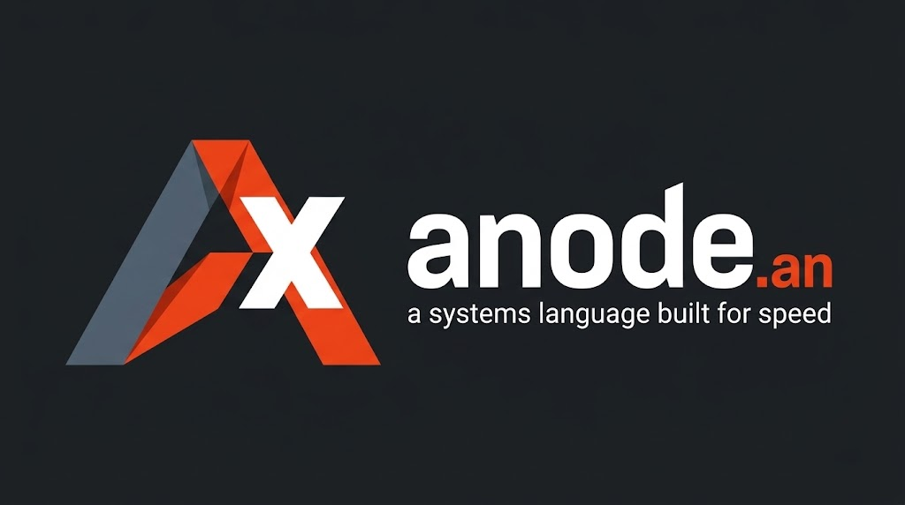
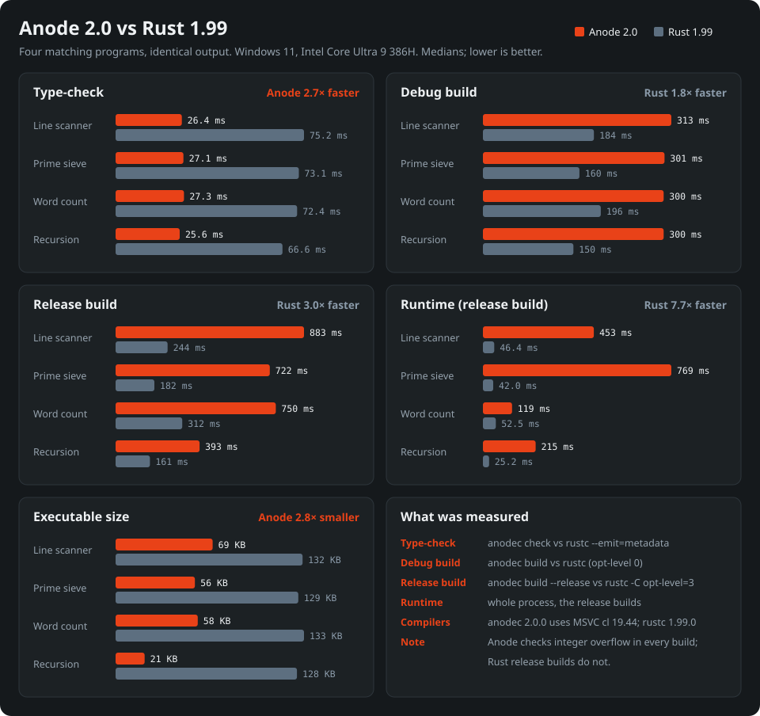

<p align="center">
  
</p>

# anode.an

Anode is a compiled systems language for Windows, Linux and macOS. Source files use the `.an` extension. Its compiler, `anodec`, is written in Anode and compiles itself.

- **Ownership without lifetimes:** the syntax is close to Rust, with ownership and moves, but there are no lifetime annotations. A borrowed element or region exists only inside the `borrow` block that created it.
- **Interfaces and generics:** `interface Shape` with `impl Shape for Rect`, and generic functions such as `fn larger<A: Shape, B: Shape>`. A generic function is compiled separately for each type it is called with, so its calls are direct.
- **Effects:** `@effect(no_alloc, no_io, bounded)` states that a function never allocates, does no I/O and always finishes. The compiler checks it through every call, including calls through interfaces and function values.
- **Checked arithmetic:** arithmetic, array bounds and number conversions are checked in every build.
- **C as the backend:** `anodec` generates C and compiles it with MSVC, clang-cl, clang, gcc or cc. Programs can call C libraries through `extern "C"`.

Version **2.0.0** · MIT License · [Download](https://github.com/PappyVanPoodle/anode/releases/latest) · [Language guide](AGENTS.md) · [Standard library API](docs/API-DOCS.md) · [Benchmarks](benchmarks/README.md)

## Example

```anode
pub interface Shape {
    @effect(no_alloc, no_io, bounded)
    fn area(self: &Self) -> int;
}
pub struct Rect { width: int, height: int }
pub struct Square { side: int }
impl Shape for Rect {
    @effect(no_alloc, no_io, bounded)
    fn area(self: &Self) -> int { return self.width * self.height; }
}
impl Shape for Square {
    @effect(no_alloc, no_io, bounded)
    fn area(self: &Self) -> int { return self.side * self.side; }
}
// Compiled once for each pair of types it is called with; area() calls are direct.
@effect(no_alloc, no_io, bounded)
fn larger<A: Shape, B: Shape>(a: &A, b: &B) -> int {
    let x = a.area();
    let y = b.area();
    if x > y { return x; }
    return y;
}
fn main() {
    let r = Rect { width: 3, height: 4 };
    let s = Square { side: 5 };
    print larger(&r, &s);
}
```

`anodec run .` prints `25`. If `Rect`'s `area` left out the `@effect` line, `anodec check` would reject the program:

```text
./src/main.an:8: method area of impl main::Shape for main::Rect must declare @effect(no_alloc, no_io, bounded) like the interface
```

## Speed compared with Rust

<p align="center">
  
</p>

Four programs, written once in Anode and once in idiomatic Rust, print identical output.

- **Anode wins:** it type-checks 2.7× faster, and its executables are 2.8× smaller.
- **Rust wins:** it builds faster (1.8× for debug builds and 3.0× for release builds), and its programs run 7.7× faster.

Anode 2.0 compiles every value to a tagged, boxed value, and it checks integer overflow and bounds in every build. Rust's release builds do not check overflow. [benchmarks/](benchmarks/README.md) has the programs, every number and how to rerun them.

## Install

Download the archive for your platform from the [latest release](https://github.com/PappyVanPoodle/anode/releases/latest):

| Archive | Runs on |
| :--- | :--- |
| `anode-2.0.0-windows-x64.zip` | Windows 10 or 11, x64 |
| `anode-2.0.0-linux-x64.tar.gz` | Linux x64 with glibc 2.34 or newer: Ubuntu 22.04+, Debian 12+, RHEL, Rocky or Alma 9+, Fedora 35+ |
| `anode-2.0.0-macos-arm64.tar.gz` | macOS 11 or newer on Apple silicon |

Anode compiles your program to C, so you also need a C compiler.

- **Windows:** Visual Studio Build Tools with the **Desktop development with C++** workload. Extract the zip, for example to `C:\Tools\anode-2.0.0-windows-x64`, then in PowerShell:

  ```powershell
  $sdk = "C:\Tools\anode-2.0.0-windows-x64"
  [Environment]::SetEnvironmentVariable("ANODE_HOME", $sdk, "User")
  [Environment]::SetEnvironmentVariable("Path", [Environment]::GetEnvironmentVariable("Path", "User") + ";$sdk\bin", "User")
  ```

- **Linux:** clang or gcc (`sudo apt install clang`). Then:

  ```bash
  tar -xzf anode-2.0.0-linux-x64.tar.gz -C ~
  echo 'export ANODE_HOME="$HOME/anode-2.0.0-linux-x64"' >> ~/.bashrc
  echo 'export PATH="$ANODE_HOME/bin:$PATH"' >> ~/.bashrc
  ```

- **macOS:** Apple's clang (`xcode-select --install`). Then:

  ```bash
  tar -xzf anode-2.0.0-macos-arm64.tar.gz -C ~
  echo 'export ANODE_HOME="$HOME/anode-2.0.0-macos-arm64"' >> ~/.zshrc
  echo 'export PATH="$ANODE_HOME/bin:$PATH"' >> ~/.zshrc
  ```

  The binaries are not signed. If macOS refuses to open `anodec`, run `xattr -dr com.apple.quarantine ~/anode-2.0.0-macos-arm64`.

Open a new terminal, run `anodec doctor` to confirm it found your C compiler, and try a first program:

```
anodec new hello
cd hello
anodec run
```

## Commands

| Command | What it does |
| :--- | :--- |
| `anodec new NAME` | Creates a project: `Anode.toml`, `src/main.an`, `AGENTS.md` and `CLAUDE.md` |
| `anodec add json cli` | Adds standard packages to `[dependencies]` as `json = { std = true }` |
| `anodec check . --json` | Type, ownership, borrow and effect checks; diagnostics with file and line |
| `anodec test .` | Runs each `test` block in its own process |
| `anodec run . -- ARGS` | Builds and runs the program and returns its exit code |
| `anodec build . -o app` | Builds an executable; `--release` optimizes it, `--debug` adds debugger information |
| `anodec doctor` | Shows `ANODE_HOME`, the C runtime, the C compiler and the standard packages; `--json` for tools |
| `anodec version` | Prints the version |

`anode` in the same `bin` folder is the same compiler under a second name. `anodec` uses MSVC by default on Windows. To use another C compiler, set `ANODE_CC` to `clang-cl`, `clang`, `gcc` or `cc` before your first build.

## Standard library

`packages/` has eight libraries written in Anode. None of them may read files, start processes or use the network. `anodec add json` adds `json = { std = true }` to `Anode.toml`, which finds the package in `$ANODE_HOME/packages`.

Six of them build and pass their tests under 2.0: `bench`, `cli`, `csv_jsonl`, `docgen`, `glob_regex` and `json`. `encoding` and `markdown` still need the 1.3 compiler (see [Earlier releases](#earlier-releases)).

| Package | Contents |
| :--- | :--- |
| [`cli`](packages/cli/src/lib.an) | Command-line parsing: subcommands, `--key=value`, `--flag`, `-abc`, `--`; help text |
| [`encoding`](packages/encoding/src/lib.an) | CRC-32, hex and base64 (RFC 4648); the decoders write into a buffer you pass in |
| [`csv_jsonl`](packages/csv_jsonl/src/lib.an) | CSV rows with quoted fields; string and integer fields from JSON Lines |
| [`markdown`](packages/markdown/src/lib.an) | Splits a document into headings, paragraphs, code blocks and list items, with word and sentence counts |
| [`glob_regex`](packages/glob_regex/src/lib.an) | Glob matching (`*`, `?`, `[a-z]`) and a small pattern search (`^`, `$`, `.`); neither allocates |
| [`json`](packages/json/src/lib.an) | JSON parser into an arena-backed tree, path queries such as `limits.depth`, compact output |
| [`docgen`](packages/docgen/src/lib.an) | Markdown API documentation from `.an` source files |
| [`bench`](packages/bench/src/lib.an) | Min, median, 95th percentile and max of timing samples; Markdown and JSON reports |

[docs/API-DOCS.md](docs/API-DOCS.md) lists all 72 public items; it was generated with `docgen`.

## Compared with C and Rust

The same line scanner written three ways. It reads `label|amount` lines, skips blank and `#` lines, and counts rows, the total and malformed lines. All three were compiled (MSVC `/W4`, `rustc` 2021 edition, `anodec` 2.0) and print `2 10 1` for `"# c\nalpha|12\nbad\nb|-2\n"`.

| | C | Rust | Anode |
| :--- | :--- | :--- | :--- |
| Buffer bounds | Checked by hand (`digits[32]`) | Checked | Checked (`byte_at`) |
| Lifetime annotations | — | `Entry<'a>`, `parse<'a>` | None |
| No allocation / no I/O / terminates, stated in the signature | No | No | `@effect(no_alloc, no_io, bounded)` |
| Signed integer overflow | Undefined behavior | Panics in debug builds, wraps in release builds | Stops the program in every build |

<details open>
<summary>Anode</summary>

```anode
pub struct Stats {
    rows: int,
    total: int,
    errors: int
}
// Folds the line src[start..end) into `s`: no allocation, no I/O, always finishes.
@effect(no_alloc, no_io, bounded)
fn add_line(src: &text, start: int, end: int, s: &mut Stats) {
    for i in start..end {
        if byte_at(src, i) == 124 {
            let mut pos = i + 1;
            let mut negative = false;
            if pos < end && byte_at(src, pos) == 45 { negative = true; pos = pos + 1; }
            if i == start || pos == end { break; }
            let mut amount = 0;
            for j in pos..end {
                let digit = byte_at(src, j) - 48;
                if digit < 0 || digit > 9 { s.errors = s.errors + 1; return; }
                amount = amount * 10 + digit;
            }
            if negative { amount = 0 - amount; }
            s.rows = s.rows + 1;
            s.total = s.total + amount;
            return;
        }
    }
    s.errors = s.errors + 1;
}
@effect(no_alloc, no_io, bounded)
pub fn scan(src: &text) -> Stats {
    let mut s = Stats { rows: 0, total: 0, errors: 0 };
    let mut start = 0;
    for i in 0..len(src) + 1 {
        if i == len(src) || byte_at(src, i) == 10 {
            if i > start && byte_at(src, start) != 35 {
                add_line(&src, start, i, &mut s);
            }
            start = i + 1;
        }
    }
    return s;
}
```
</details>

<details>
<summary>Rust</summary>

```rust
#[derive(Debug, Default)]
pub struct Stats {
    pub rows: u64,
    pub total: i64,
    pub errors: u64,
}

/// A parsed row borrows its label from the line, so the struct
/// and the function both carry the lifetime `'a`.
pub struct Entry<'a> {
    pub label: &'a str,
    pub amount: i64,
}

pub fn parse<'a>(line: &'a str) -> Option<Entry<'a>> {
    let (label, digits) = line.split_once('|')?;
    if label.is_empty() {
        return None;
    }
    let amount = digits.parse::<i64>().ok()?;
    Some(Entry { label, amount })
}

pub fn scan(src: &str) -> Stats {
    let mut s = Stats::default();
    for line in src.lines() {
        if line.is_empty() || line.starts_with('#') {
            continue;
        }
        match parse(line) {
            Some(entry) => {
                s.rows += 1;
                s.total += entry.amount;
            }
            None => s.errors += 1,
        }
    }
    s
}
```
</details>

<details>
<summary>C</summary>

```c
#include <stdlib.h>
#include <string.h>

typedef struct { long rows, total, errors; } Stats;

/* Caller must pass the true length of `line`; nothing checks it. */
static int parse_amount(const char *line, size_t len, long *amount) {
    const char *bar = memchr(line, '|', len);
    if (!bar || bar == line) return 0;
    char digits[32];                          /* fixed buffer: size checked by hand */
    size_t n = len - (size_t)(bar + 1 - line);
    if (n == 0 || n >= sizeof digits) return 0;
    memcpy(digits, bar + 1, n);
    digits[n] = '\0';
    char *end;
    *amount = strtol(digits, &end, 10);       /* out-of-range input silently clamps */
    return *end == '\0';
}

Stats scan(const char *src, size_t len) {
    Stats s = {0, 0, 0};
    size_t start = 0;
    for (size_t i = 0; i <= len; i++) {
        if (i == len || src[i] == '\n') {
            if (i > start && src[start] != '#') {
                long amount;
                if (parse_amount(src + start, i - start, &amount)) {
                    s.rows++;
                    s.total += amount;        /* signed overflow is undefined */
                } else {
                    s.errors++;
                }
            }
            start = i + 1;
        }
    }
    return s;
}
```
</details>

## AGENTS.md and CLAUDE.md

`anodec new` writes `AGENTS.md` and `CLAUDE.md` into every new project, for code assistants working in it. [AGENTS.md](AGENTS.md) covers how the syntax differs from Rust, collections and borrows, effects, every builtin, and the standard library; section 2.2 lists the mistakes the compiler rejects most often. It was written for 1.3, so a few of the features it describes, such as field views and `requires` / `ensures`, need the 1.3 compiler. [CLAUDE.md](CLAUDE.md) is a short checklist that points to it.

## Tests

- **Compiler:** 76 tests pass on Windows x64, Linux x64 and macOS ARM64 in continuous integration. On each platform, `anodec` also rebuilds itself and emits, byte for byte, the C it was built from.
- **Standard library:** the six packages that build under 2.0 pass their 21 tests.

## Earlier releases

[Anode 1.3.0](https://github.com/PappyVanPoodle/anode/releases/tag/v1.3.0) shipped `anode`, an earlier compiler written in Rust, for Windows only. It is still available, and its source is in [compiler/](compiler).

It supports a larger language than 2.0:

- field views such as `&mut Counter.{ mut value }`;
- `requires` / `ensures` conditions;
- threads, `http_request` and binary file I/O;
- `anode fmt`, `anode verify` and a Cranelift backend.

[examples/stdlib-showcase](examples/stdlib-showcase) and [docs/LANGUAGE.md](docs/LANGUAGE.md) describe that release. 617 compiler tests passed in its release run.

## License

Anode, its standard library packages and the compiler source in this repository are released under the [MIT License](LICENSE).

The 1.3.0 Windows SDK includes third-party components, including Cranelift and the Rust standard library. Their license terms and notices are in [THIRD-PARTY/README.txt](THIRD-PARTY/README.txt).

## Repository layout

```text
README.md               this page
LICENSE                 MIT License
AGENTS.md  CLAUDE.md    guides for code assistants (also written by `anodec new`)
install.ps1             per-user installer for the 1.3.0 Windows SDK
assets/                 logo, icon and the benchmark chart
benchmarks/             Anode 2.0 compared with Rust: programs, results and scripts
THIRD-PARTY/            notices for third-party components in the 1.3.0 SDK
docs/                   API-DOCS.md, BENCHMARK.md, LANGUAGE.md, SAFETY.md
packages/               the eight standard library packages
examples/               stdlib-showcase (1.3)
compiler/               Rust source of the 1.3 compiler and language server; anodec/ is the
                        Anode source of anodec 1.4
site/                   GitHub Pages landing page
```

The 2.0 compiler ships in the archives of the [2.0.0 release](https://github.com/PappyVanPoodle/anode/releases/tag/v2.0.0). The 1.3.0 binaries (`anode.exe`, `zn.exe`, `anode-lsp.exe`, `anodec.exe`) ship in the 1.3.0 zip, and [compiler/](https://github.com/PappyVanPoodle/anode/tree/main/compiler) has their source and build steps. Further reading: [docs/LANGUAGE.md](docs/LANGUAGE.md) (language reference by release) and [docs/SAFETY.md](docs/SAFETY.md) (safety boundary and capability model).
